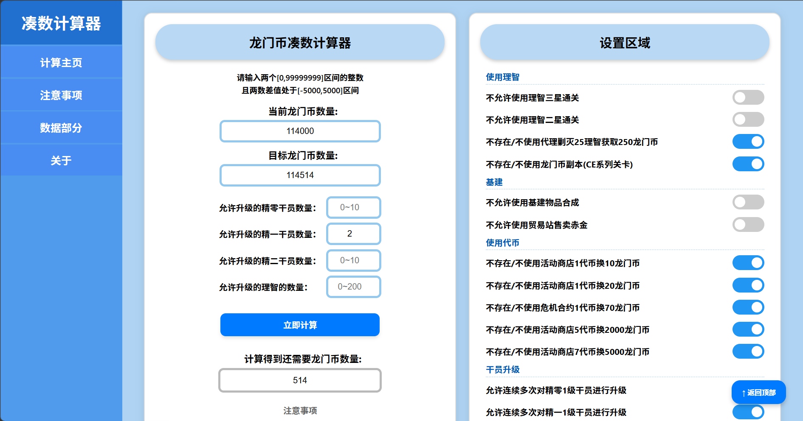
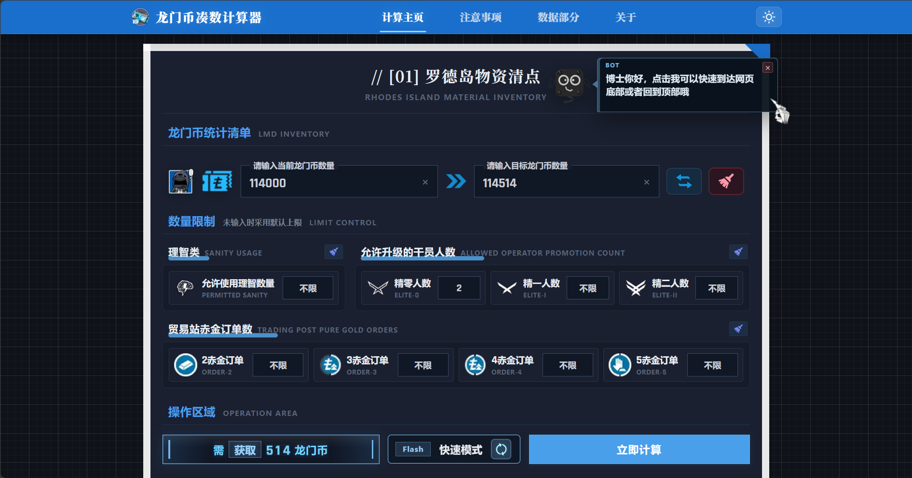

# 明日方舟龙门币凑数计算器

## 🎯项目介绍

这里是明日方舟龙门币凑数计算器，通过计算多个可执行的获取/消耗龙门币方案，帮助你凑出任意龙门币尾数。

本项目是我在2025年初学习前端时做的一个简单练习项目，当时遇到了凑龙门币尾数的需求，但发现此前另一位开发者的凑数计算器因公招不再消耗龙门币而失效，因此在亲爱的D老师和G老师的指导下完成并上线了1.0版本。

上线之后，我一直在关注各个社交平台和游戏社区中的使用情况和反馈，针对各种问题陆续进行优化。



2026年1月，我开始尝试使用claude code和codex辅助开发，并且计划项目重构。2026年4月~6月期间，2.0版本对前端页面设计、移动端适配、计算结果展示和后端计算服务等方面做了较大调整，前端使用TypeScript重写，后端使用Go重构。



## 🌐在线使用

点击访问：[https://ark-lmd.top/](https://ark-lmd.top/)

网页端和移动端均已适配。

## 🔧食用说明

- 打开计算主页。
- 在输入面板中输入当前龙门币数量、目标龙门币数量（范围：0 ~ 99,999,999，差值限制：-5000 ~ 5000）、允许升级的干员数量（0 ~ 10）、允许使用的理智数量（0 ~ 210）和贸易站赤金订单数（0 ~ 10）。
- 在配置面板自定义计算规则（例如禁用某些物品）。
- 点击“立即计算”按钮，查看生成的方案。
- 访问“注意事项”、“数据档案”和“关于”页面以了解更多信息。

## 🗣️页面说明

当前主要页面包括：

- `计算主页`：输入龙门币数量、设置限制、调整计算规则并查看推荐方案。
- `注意事项`：针对输入范围、升级误差、连续升级等容易误解的规则进行说明。
- `数据档案`：展示升级消耗、物品价值、理智速查和方案样例。
- `关于`：展示项目信息、运行统计、反馈入口、外部链接、版本时间轴和声明。
- `维护页`：用于在维护期间显示维护状态和可参考的预制方案样例。
- `后台统计页`：隐藏页面，用于查看服务状态。

## 📦本地部署

### 环境参考

当前项目开发环境参考：

- Node.js：v22.13.0
- npm：10.9.2
- Go：1.26.3
- React：18.2.0
- TypeScript：5.7.0
- Vite：6.1.0

### 安装与启动

Windows 本地开发可以双击项目根目录的 `start-dev.cmd`，或在 PowerShell 中执行：

```powershell
powershell.exe -NoProfile -ExecutionPolicy Bypass -File .\start-dev.ps1
```

脚本需要已安装 Node.js、Go，并在项目根目录执行过 `npm install`。它会先检查端口和前端依赖，再启动 Go 后端，等待后端就绪后启动前端。

- 前端地址：`http://localhost:3000/`，启动后手动在浏览器中打开。
- 后端地址：`http://localhost:3003/`，使用 `NODE_ENV=test`，关闭本地调试限流。
- 开发 API 地址和跨域来源由脚本统一配置，端口被占用时会提示并停止。
- 在启动终端按 `Ctrl+C` 可停止前后端；修改 Go 代码后需要停止并重新启动。
- 前后端输出显示在同一终端，后端运行日志保存在 `go-backend/logs/`；本地后端可执行文件也生成在该目录，不纳入 Git。

也可以分别启动前后端。前端命令：

```bash
npm install
npm run dev
```

Vite 默认会给出本地访问地址，通常是：

```text
http://localhost:3000/
```

前端开发环境会读取 `.env.development`：

```text
VITE_API_URL=http://localhost:3003
```

如需本地调试完整计算功能，需要同时启动 Go 后端：

```powershell
cd go-backend
$env:PORT="3003"
$env:NODE_ENV="test"
$env:CORS_ORIGIN="http://localhost:3000"
go run ./cmd/server
```

默认端口是 `3003`。`NODE_ENV=test` 时会关闭接口限流，方便本地调试和测试。

## 多语言开发

当前使用 `i18next` 和 `react-i18next`，已接通简体中文（`zh-CN`）与繁体中文（`zh-TW`）切换。繁体中文试用覆盖导航及公共提示、计算输入和配置、结果步骤、复制文本及计算错误提示。助手的通用文案及其他页面还在适配，游戏术语仍待人工校对。

- 点击导航右侧地球按钮切换语言，无需刷新页面。输入、设置与计算结果不因语言切换而重置。
- 首次访问默认简体中文；用户选择保存在当前站点的 `localStorage`，键为 `ark_lmd_language`。刷新后恢复选择；存储不可用时仍可在当前页面切换。
- 暂不根据浏览器语言自动选择。不支持或无效的已保存语言使用简体中文。
- 语言初始化在 `src/i18n/index.ts`，同步更新 `<html lang>` 和浏览器标题；缺失或为空的繁体译文回退到对应简体译文。两种语言都缺失的键仍会显示键名，因此新增文案时必须先补充简体资源。
- 文案分别保存在 `src/i18n/locales/zh-CN/common.json` 和 `src/i18n/locales/zh-TW/common.json`。后续可以按页面增加命名空间；目前均随前端一起打包，切换无需在线翻译接口。
- 计算主页文案使用独立的 `calculator` 命名空间，分别位于两个语言目录的 `calculator.json`。组件使用 `useTranslation("calculator")` 读取；设置完整描述与移动端短标题分别存放在 `settings.options` 的 `text` 和 `highlight` 中，修改术语时应一起校对。帮助中的 `<keyword>` 是强调标记，翻译时保留标签及 `{{label}}`、`{{max}}` 等变量。
- 结果区与剪贴板文案保存在两种语言的 `results.json`。繁体操作名称在 `src/i18n/locales/zh-TW/gameItems.json` 中按条目 `id` 查找，缺少译文时显示原始的简体名称。
- 在 React 组件中调用 `useTranslation()`，通过 `t("nav.data")` 等稳定键读取文字；带变量的文案使用 `t("nav.goTo", { page: t("nav.data") })`。简体资源同时作为 TypeScript 文案键的类型来源。
- 新增公共文案时，先补充简体 JSON 中的键，再添加同名繁体译文，并替换组件中的文字。繁体术语可直接在繁体资源内校对，无需改动页面结构。
- 语言选择仅影响展示，不切换游戏服务器、CE 开放日规则或计算数据。台湾服规则与特殊字体覆盖需后续单独核对。

本地验收时，检查切换后的导航、菜单当前项、浏览器标题与 `<html lang>`；刷新后确认选择恢复，并检查手机宽度下菜单及按钮布局。不同浏览器或 `localhost`、局域网 IP 等不同访问来源分别保存语言偏好。

运行 `npm run test:i18n` 检查语言回退、存储和页面信息同步，以及主页简繁资源的键、变量、强调标签和规则数字一致性；运行 `npm run typecheck` 检查组件文案键。

## 参考资料

- [干员升级经验及龙门币消耗成本统计(收束测试)](https://ngabbs.com/read.php?tid=16847042)
- [[工具发布]凑龙门币~](https://bbs.nga.cn/read.php?tid=21247901)
- [PRTS Wiki](https://prts.wiki/w/)

## 声明

本项目仅用于学习交流使用。网页所涉及的游戏《明日方舟》相关的名称、数据、素材等均为其各自所有者的资产，仅供识别。
